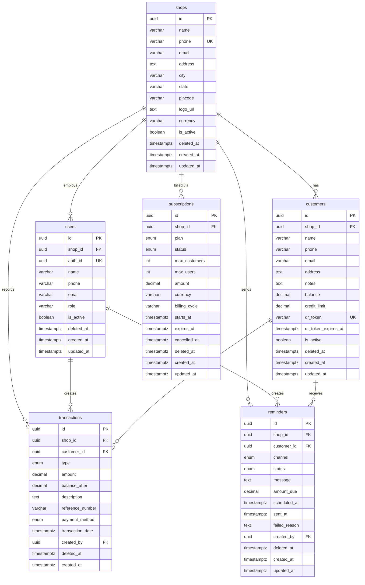
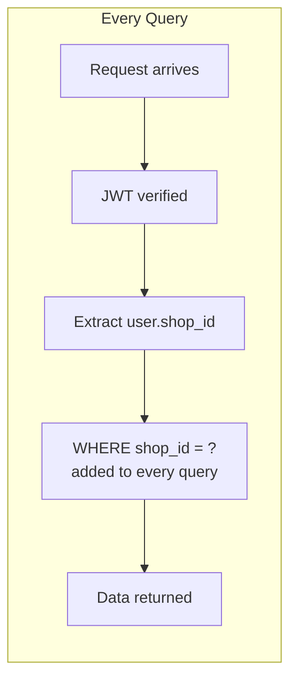
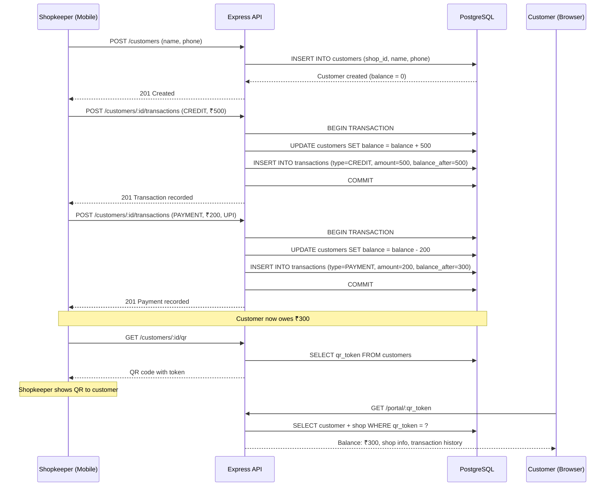

# Udhari SaaS — Database Schema Documentation

## Entity-Relationship Diagram



---

## Table-by-Table Explanation

### 1. `shops` — Tenant Root

The anchor of the multi-tenant architecture. **Every other table** has a `shop_id` foreign key pointing here, ensuring complete data isolation between shops.

| Column | Purpose |
|--------|---------|
| `id` | UUID primary key |
| `name` | Shop display name (e.g., "Sharma General Store") |
| `phone` | Unique phone number — also used for OTP login |
| `email` | Optional contact email |
| `address`, `city`, `state`, `pincode` | Physical location for display on customer portal |
| `logo_url` | Shop branding for the customer portal header |
| `currency` | Default currency for all monetary values (default: `INR`) |
| `is_active` | Quick toggle to disable a shop without deleting |
| `deleted_at` | Soft delete — `NULL` means active |

**Indexes:**
- `idx_shops_phone` — fast lookup by phone (login)
- `idx_shops_is_active` — partial index on non-deleted active shops

---

### 2. `users` — Shopkeepers & Staff

People who can log into the mobile app and manage a shop. The `auth_id` links to Supabase Auth (the user who authenticated via phone OTP).

| Column | Purpose |
|--------|---------|
| `shop_id` | Which shop this user belongs to |
| `auth_id` | Supabase Auth UID — unique across all users |
| `role` | `owner` or `staff` — for future RBAC |
| `is_active` | Disable staff access without deleting |

**Constraints:**
- `UNIQUE(shop_id, phone)` — no duplicate phone numbers within a shop (partial, only non-deleted)
- `UNIQUE(auth_id)` — one Supabase account = one user

**Why separate from `shops`?** A shop may have multiple staff members in the future. The owner is just a user with `role = 'owner'`.

---

### 3. `customers` — Credit Book Entries

The people who owe money to (or are owed by) a shop. Each customer belongs to exactly one shop.

| Column | Purpose |
|--------|---------|
| `balance` | Current outstanding amount. Positive = customer owes the shop. Updated atomically with each transaction. |
| `credit_limit` | Maximum allowed credit. `0` means unlimited. The app should warn/block when a new CREDIT transaction would exceed this. |
| `qr_token` | URL-safe token embedded in QR codes. When scanned, opens the customer portal at `/customer/{qr_token}`. |
| `qr_token_expires_at` | Optional expiry for the QR token. `NULL` = never expires. |
| `is_active` | Soft-disable a customer (e.g., blacklisted) without losing history. |

**Constraints:**
- `UNIQUE(shop_id, phone)` — no duplicate customers within a shop
- `UNIQUE(qr_token)` — globally unique portal access token

**Key Indexes:**
- `idx_customers_shop_id` — list all customers for a shop
- `idx_customers_qr_token` — O(1) portal token lookup
- `idx_customers_balance` — sort/filter by outstanding amount

---

### 4. `transactions` — Immutable Ledger

The financial heart of the system. Every credit extension, debit adjustment, and payment is recorded as a transaction.

| Type | Effect on `balance` | Example |
|------|-------------------|---------|
| `CREDIT` | +amount (customer owes more) | "₹500 groceries on credit" |
| `DEBIT` | −amount (customer owes less) | "₹100 return/adjustment" |
| `PAYMENT` | −amount (customer paid back) | "₹300 paid via UPI" |

| Column | Purpose |
|--------|---------|
| `amount` | Always positive. The `type` determines the direction. |
| `balance_after` | Snapshot of `customer.balance` after this transaction. Enables auditing without replaying the entire history. |
| `payment_method` | Only populated for `PAYMENT` type transactions. |
| `reference_number` | External reference (UPI transaction ID, cheque number, etc.) |
| `created_by` | The user (shopkeeper/staff) who recorded this entry. |

**Design Decision — No `updated_at`:**
Transactions are **immutable ledger entries**. To "edit" a transaction, you soft-delete it (`deleted_at`) and create a corrective entry. This preserves a complete audit trail.

**Indexes:**
- `idx_txn_shop_customer` — list transactions for a specific customer
- `idx_txn_date` — chronological listing with DESC sort
- `idx_txn_type` — filter by CREDIT/DEBIT/PAYMENT

---

### 5. `subscriptions` — SaaS Billing

Tracks the shop's subscription plan and enforces resource limits.

| Plan | Max Customers | Max Users | Price |
|------|--------------|-----------|-------|
| `FREE` | 50 | 1 | ₹0 |
| `BASIC` | 200 | 2 | ₹199/mo |
| `PRO` | 1000 | 5 | ₹499/mo |
| `ENTERPRISE` | Unlimited | Unlimited | Custom |

| Column | Purpose |
|--------|---------|
| `plan` | Enum: FREE, BASIC, PRO, ENTERPRISE |
| `status` | ACTIVE, EXPIRED, CANCELLED, PAST_DUE |
| `max_customers` | Enforced limit — checked when adding new customers |
| `max_users` | Enforced limit — checked when adding new staff |
| `billing_cycle` | `monthly` or `yearly` |
| `starts_at` / `expires_at` | Subscription validity window |
| `cancelled_at` | When the shop explicitly cancelled |

**Indexes:**
- `idx_sub_status` — find active subscription for a shop
- `idx_sub_expires` — cron job to expire subscriptions

---

### 6. `reminders` — Payment Notifications

Allows shopkeepers to send payment reminders to customers via SMS, WhatsApp, or email.

| Column | Purpose |
|--------|---------|
| `channel` | SMS, WHATSAPP, or EMAIL |
| `status` | PENDING → SENT or FAILED |
| `message` | The reminder text (can be templated) |
| `amount_due` | Snapshot of balance at time of reminder creation |
| `scheduled_at` | When the reminder should be sent (supports scheduling) |
| `sent_at` | Actual send timestamp |
| `failed_reason` | Error message if delivery failed |

**Indexes:**
- `idx_rem_scheduled` — cron job picks up PENDING reminders by schedule time
- `idx_rem_status` — filter reminders by status per shop

---

## Multi-Tenancy Strategy



**Rules enforced at the application layer:**
1. The `shopContext` middleware extracts `shop_id` from the authenticated user's JWT
2. Every service method receives `shopId` and includes it in the Prisma `where` clause
3. No query ever runs without a `shop_id` filter (except portal token lookups, which use the globally-unique `qr_token`)

---

## Soft Delete Strategy

All tables use `deleted_at TIMESTAMPTZ` instead of hard deletes.

```
deleted_at = NULL   →  Record is active
deleted_at = <date> →  Record is soft-deleted
```

**Query pattern:** Every `findMany` / `findFirst` includes `deletedAt: null` in the where clause. A utility wrapper handles this automatically.

**Why soft delete?**
- Financial data must never be permanently lost
- Undo/recovery capability
- Audit trail integrity (transactions reference customers — hard-deleting a customer would orphan transactions)

---

## Index Strategy Summary

| Table | Index | Purpose |
|-------|-------|---------|
| `shops` | `phone` | Login lookup |
| `users` | `shop_id`, `auth_id` | Tenant filter, auth lookup |
| `customers` | `shop_id`, `qr_token`, `(shop_id, balance)`, `(shop_id, phone)` | Tenant filter, portal access, top debtors, duplicate check |
| `transactions` | `shop_id`, `customer_id`, `(shop_id, customer_id)`, `(shop_id, date DESC)`, `(shop_id, type)` | All common query patterns |
| `subscriptions` | `shop_id`, `(shop_id, status)`, `expires_at` | Plan checks, expiry cron |
| `reminders` | `shop_id`, `customer_id`, `(shop_id, status)`, `scheduled_at` | Delivery queue, history |

Most indexes include a `WHERE deleted_at IS NULL` partial filter (in the raw SQL) to exclude soft-deleted rows from index maintenance.

---

## Data Flow Example


